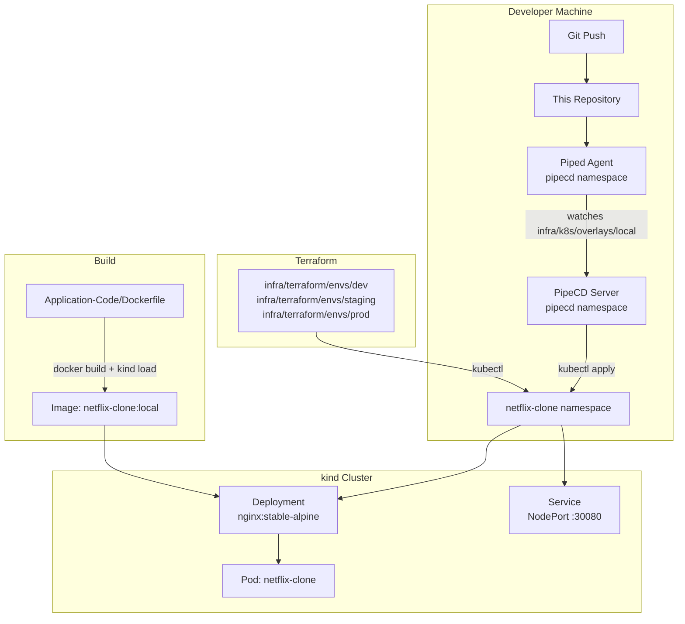

# Design Document: Netflix Clone PipeCD Infrastructure

## Overview

This document describes the infrastructure design for deploying the Netflix Clone React SPA (TypeScript + Vite + MUI) to a local `kind` Kubernetes cluster using PipeCD as the GitOps continuous delivery platform. All components run fully offline on a developer's local machine.

The system is composed of four interlocking concerns:

1. **GitOps repository layout** — structured directories that PipeCD can watch
2. **Container image build** — reproducible Docker build loaded directly into kind
3. **Kubernetes manifests** — Kustomize-layered manifests across three environments (dev/staging/prod)
4. **Terraform infrastructure** — codified namespace provisioning using the kubernetes provider
5. **Gangsta AI harness** — steering files that govern AI agent behavior during infra work

---

## Architecture



The Piped agent continuously polls this repository. On detecting a change under `infra/k8s/`, it triggers a PipeCD sync pipeline that applies the Kustomize overlay for the target environment to the cluster.

---

## Components and Interfaces

### 1. Repository Directory Layout

```
.
├── Application-Code/           # Existing React SPA + Dockerfile
├── infra/
│   ├── terraform/
│   │   ├── modules/
│   │   │   └── namespace/      # Reusable namespace module
│   │   │       ├── main.tf
│   │   │       ├── variables.tf
│   │   │       ├── outputs.tf
│   │   │       └── versions.tf
│   │   └── envs/
│   │       ├── dev/            # Dev environment root module
│   │       │   ├── main.tf
│   │       │   ├── variables.tf
│   │       │   ├── outputs.tf
│   │       │   └── versions.tf
│   │       ├── staging/        # Staging environment root module
│   │       │   ├── main.tf
│   │       │   ├── variables.tf
│   │       │   ├── outputs.tf
│   │       │   └── versions.tf
│   │       └── prod/           # Prod environment root module
│   │           ├── main.tf
│   │           ├── variables.tf
│   │           ├── outputs.tf
│   │           └── versions.tf
│   └── k8s/
│       ├── base/               # Environment-agnostic manifests
│       │   ├── namespace.yaml
│       │   ├── deployment.yaml
│       │   ├── service.yaml
│       │   └── kustomization.yaml
│       └── overlays/
│           ├── local/          # PipeCD-watched overlay (maps to dev)
│           │   ├── kustomization.yaml
│           │   └── .pipe.yaml
│           ├── staging/
│           │   └── kustomization.yaml
│           └── prod/
│               └── kustomization.yaml
└── .kiro/
    └── steering/
        └── gangsta-infra.md
```

> **Design decision:** Three Terraform environment roots (`dev`, `staging`, `prod`) call the shared `modules/namespace` module with different input values. This keeps the module DRY while giving each environment an independent state file. The `local` Kubernetes overlay maps to the dev environment for local kind usage.

---

### 2. Container Image Build

The existing multi-stage `Application-Code/Dockerfile` is used without modification:

- **Stage 1 (builder):** `node:20-alpine` — installs deps with `yarn --frozen-lockfile`, runs `tsc && vite build`
- **Stage 2 (server):** `nginx:stable-alpine` — serves the compiled `dist/` directory

Build interface:

```bash
docker build \
  --build-arg TMDB_V3_API_KEY=<key_or_empty> \
  -t netflix-clone:local \
  ./Application-Code

kind load docker-image netflix-clone:local --name <cluster-name>
```

The image tag `netflix-clone:local` is deterministic and matches the tag referenced in the Kubernetes manifests. `imagePullPolicy: Never` is set so Kubernetes uses the image loaded into kind's containerd runtime directly, without hitting a registry.

> **Design decision:** `TMDB_V3_API_KEY` defaults to an empty string if not supplied (enforced by the `ARG` default in the Dockerfile). This satisfies Requirement 2.4 — the image builds successfully but with degraded API functionality.

---

### 3. Kubernetes Manifests

#### Base (`infra/k8s/base/`)

| File | Resource | Key settings |
|---|---|---|
| `namespace.yaml` | `Namespace` | `name: netflix-clone` |
| `deployment.yaml` | `Deployment` | `replicas: 1`, image: `netflix-clone:local`, `imagePullPolicy: Never` |
| `service.yaml` | `Service` | `type: NodePort`, `port: 80`, `nodePort: 30080` |
| `kustomization.yaml` | Kustomize root | lists all three resources |

Base manifests are intentionally environment-agnostic — no namespace field in the Deployment or Service (Kustomize overlays inject it).

#### Overlays

Each overlay's `kustomization.yaml` sets:
- `namespace: netflix-clone`
- `images:` patch to pin the exact image tag
- Any environment-specific resource patches

The `local` overlay is the one Piped watches. It also contains `.pipe.yaml`.

---

### 4. PipeCD Application Configuration (`.pipe.yaml`)

Located at `infra/k8s/overlays/local/.pipe.yaml`:

```yaml
apiVersion: pipecd.dev/v1beta1
kind: KubernetesApp
spec:
  name: netflix-clone
  labels:
    env: local
  pipeline:
    stages:
      - name: K8S_CANARY_ROLLOUT
        with:
          replicas: 1
      - name: WAIT_APPROVAL
        with:
          timeout: 10m
      - name: K8S_PRIMARY_ROLLOUT
      - name: K8S_CANARY_CLEAN
```

> **Design decision:** The pipeline includes both `K8S_CANARY_ROLLOUT` and `WAIT_APPROVAL` stages (Requirement 5.4). This demonstrates PipeCD progressive delivery: traffic goes to a canary pod first, a human approves in the PipeCD UI, then the primary rollout completes. On failure the deployment status is set to `FAILURE` and the previous state is preserved (Requirement 5.5) — PipeCD's default behavior when no auto-rollback is configured.

The `repoId: default` references the repository entry in the Piped ConfigMap. The `path` field points to `infra/k8s/overlays/local`.

---

### 5. Terraform Infrastructure Module

#### Module hierarchy

```
infra/terraform/modules/namespace/   ← reusable primitive
infra/terraform/envs/{dev,staging,prod}/  ← environment roots
```

Each environment root calls the module:

```hcl
# infra/terraform/envs/dev/main.tf
module "namespace" {
  source          = "../../modules/namespace"
  namespace_name  = "netflix-clone"
  environment     = "dev"
}
```

State is stored locally per environment:

```hcl
# versions.tf (each env root)
terraform {
  backend "local" {
    path = "terraform.tfstate"
  }
  required_providers {
    kubernetes = {
      source  = "hashicorp/kubernetes"
      version = "~> 2.31"
    }
  }
}
```

Authentication uses the local kubeconfig:

```hcl
provider "kubernetes" {
  config_path    = "~/.kube/config"
  config_context = "kind-<cluster-name>"
}
```

Module outputs export `namespace_name` for downstream reference (Requirement 4.5).

> **Design decision:** A dedicated `modules/namespace` module is used instead of inline resources to satisfy terraform-skill module conventions and to allow the same primitive to be reused across all three environment roots without duplication.

---

### 6. Gangsta AI Harness

A single steering file at `.kiro/steering/gangsta-infra.md` governs AI agent behavior for all infra tasks in this repository.

Key contents:
- **Omerta Laws:** Spec is Law, Rule of Truth, Rule of Availability
- **Heist pipeline phase mapping** to infra tasks (Reconnaissance → read existing cluster state; Grilling → validate requirements; Sit-Down → design; Resource Development → write Terraform/manifests; Execution → apply; Delivery → verify)
- **terraform-skill Response Contract** template that agents must emit before generating HCL
- **Glossary cross-reference** pointing to the terms in `requirements.md`

The file uses `inclusion: always` (default) so it is included in every AI interaction within this workspace.

---

## Data Models

### Terraform Variable Interface (namespace module)

| Variable | Type | Description |
|---|---|---|
| `namespace_name` | `string` | Kubernetes namespace name |
| `environment` | `string` | Environment label (`dev`, `staging`, `prod`) |

### Terraform Output Interface (namespace module)

| Output | Type | Description |
|---|---|---|
| `namespace_name` | `string` | The created namespace name |

### PipeCD Application labels

| Label | Value |
|---|---|
| `env` | `local` / `staging` / `prod` |
| `app` | `netflix-clone` |

---

## Error Handling

| Scenario | Handling |
|---|---|
| `TMDB_V3_API_KEY` not provided at build time | Dockerfile `ARG` defaults to empty string; image builds with degraded API functionality |
| `kind load docker-image` fails | Manual re-run required; image tag must exist locally before PipeCD sync |
| PipeCD sync fails | Pipeline status set to `FAILURE`; previous running state is preserved (no auto-rollback) |
| Terraform apply fails | Local state file remains at last known good state; re-run after fixing the conflict |
| Kustomize overlay missing namespace patch | Kustomize will error at build time before PipeCD applies resources |
| Piped ConfigMap `repoId` mismatch | PipeCD application will fail to find the repository; must match the `repoId` registered in Piped config |

---

## Testing Strategy

All testing is performed locally before committing to the GitOps path.

### Infrastructure validation

- `terraform validate` and `terraform plan` for each environment root to catch syntax and provider errors before apply
- `kubectl kustomize infra/k8s/overlays/local` to validate the Kustomize build renders without errors
- `kubectl apply --dry-run=client` against the rendered manifests to catch Kubernetes API validation errors

### End-to-end smoke test

1. Build image and load into kind: `docker build` → `kind load docker-image`
2. Run `terraform apply` in `infra/terraform/envs/dev/` to create the namespace
3. Commit a manifest change to trigger PipeCD sync
4. Approve the `WAIT_APPROVAL` stage in the PipeCD UI
5. Verify the pod is `Running`: `kubectl get pods -n netflix-clone`
6. Access the app via `http://localhost:30080`

### AI agent behavior validation

- Confirm the Gangsta steering file is loaded by checking `.kiro/steering/gangsta-infra.md` exists
- On any Terraform task, verify the AI agent emits the terraform-skill Response Contract before generating HCL
